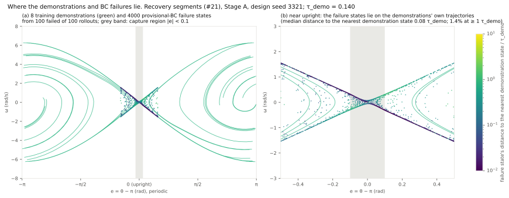
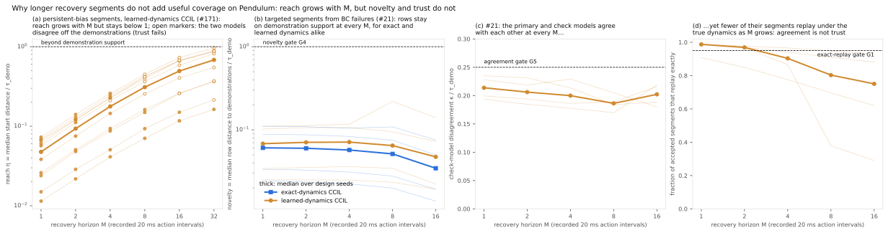
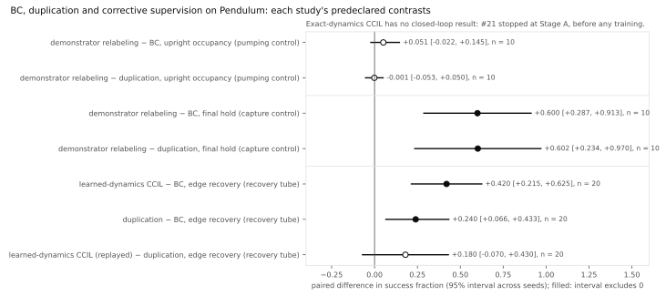

# Pendulum: what the CCIL investigation established

This is the canonical account of the Pendulum investigation (CCIL milestones M3–M4.5 and this repository's #12, #18 and #21). The study documents it cites are frozen protocols and records; this document owns the interpretation.

## Setting

- **Task:** the continuous-action Pendulum swing-up and balance, with a 20 ms action interval and actions bounded to ±3 rad/s².
- **Demonstrations:** the corrected demonstrator's dataset (sha256 `59c332bc…`), which swings up by energy pumping and balances with an LQR branch.
  - The later studies here use the r = 0.1 subset: 10 episodes, split 8 for training and 2 for validation.
  - τ_demo is the 95th-percentile distance from a validation state to the nearest training state, d = √(wrap(Δe)² + (Δω/√g)²). It is the demonstrations' own spacing.
- **Coordinates:** e = θ − π is the angle from upright and ω the angular velocity.
- **Capture region:** the demonstrator's LQR branch, |e| < 0.1. The capture control additionally required that π_D captures from the state; that check removed no state.
  - This is not the oracle's LQR terminal set Ω_c.
- **Endpoints:**
  - upright occupancy, the fraction of steps within 8° of vertical;
  - final hold, upright over the last 100 of 500 steps;
  - for the recovery tube, recovery from matched disturbances.
- **Supervision arms.** These five are kept distinct because they answer different questions:
  - **BC:** demonstrations only.
  - **Duplication:** the same added row count, resampled from the demonstrations. It adds exposure but no information.
  - **Demonstrator relabeling:** the demonstrator's own action at chosen states. It is a positive control and needs the demonstrator.
  - **Exact-dynamics CCIL:** labels generated through the true dynamics. It is the ceiling of the method.
  - **Learned-dynamics CCIL:** labels generated through a model fitted to the demonstrations. It is the method as a user would run it.

## What CCIL was supposed to show

BC fails when its own errors carry it into states the demonstrations never visited (covariate shift). CCIL generates labels at nearby states from a dynamics model, choosing each label so that it leads back toward demonstrated behavior. It should help when deployment reaches important states that are **absent from the demonstrations** yet **reachable with trustworthy labels**. The paper's method makes one-step corrections: one label per recorded transition.

## What happened

### The first measurements had to be repaired before they meant anything

- **The legacy return was defective.** Applying no torque outscored nearly every learned policy. The studies switched to upright occupancy, under which zero action scores 0.
- **The printed demonstrator does not reproduce the demonstrations.** The diagnosis found a wrapping inconsistency between its LQR window and its LQR term. A corrected demonstrator and dataset replaced it.
- **Exact reproduction of the paper's Pendulum figure was withdrawn** before any run: the legacy stack cannot be rebuilt and its defects were deliberately corrected.

Sources: CCIL [M3 closeout](https://github.com/personalrobotics/CCIL/blob/d84e528/docs/experiments/pendulum-m3-closeout.md).

### The original improvement was confounded by training exposure

- **The gain.** On the corrected demonstrations, CCIL improved upright occupancy over BC on continuous Pendulum: +0.208 [0.138, 0.277] at 98.75%. No advantage was detected on discontinuous Pendulum (CCIL M3 closeout).
- **The control.** The CCIL arm adds 20 synthetic rows per demonstration row. Under an epoch-based recipe, that also multiplies the optimizer updates by 21.1. The [recovery-tube study](https://github.com/personalrobotics/il-supervision-benchmarks/pull/20) separated the two effects with a duplication arm matched in rows and sampler exposure, trained as a pair with a replay of the CCIL arm. Its endpoint is edge-bin recovery, 20 seeds, exploratory:
  - **learned-dynamics CCIL − BC:** +0.420 [+0.215, +0.625];
  - **duplication − BC:** +0.240 [+0.066, +0.433]. Duplication adds no information, yet it accounts for 57% of the gain at the point estimates;
  - **learned-dynamics CCIL − duplication:** +0.180 [−0.070, +0.430]. The gain is **not attributable to corrective information**. That benefit is unresolved, not disproven.
- **The lesson:** "equal epochs" is not equal optimization. A supervision method that adds rows must be compared with duplication at matched optimizer steps.

### Capture supervision helps, but it is not missing-state supervision

- **Pumping control** ([positive-control record](https://github.com/personalrobotics/il-supervision-benchmarks/pull/17), predeclared):
  - **The test:** demonstrator relabeling at BC-visited states in the energy-pumping region.
  - **Labels:** they reduced held-out action error. Relabel − BC was −0.722 and relabel − duplication −0.719, both intervals below 0.
  - **Closed loop:** occupancy showed no detectable difference: relabel − BC +0.051 [−0.022, +0.145], relabel − duplication −0.001 [−0.053, +0.050].
  - **Outcome:** **not established.**
- **Capture control** ([capture-control record](https://github.com/personalrobotics/il-supervision-benchmarks/pull/17), exploratory):
  - **The test:** demonstrator relabeling at BC-visited states in the capture region.
  - **Final hold:** relabel 1.00 on every seed, against 0.40 for both BC and duplication. Relabel − duplication was +0.602 [+0.234, +0.970].
  - **What it shows:** recovery supervision at the right states matters.
- **Recovery segments** ([Stage A record](https://github.com/personalrobotics/il-supervision-benchmarks/pull/23), #21):
  - **Where BC fails:** in the approach to upright, but **on the demonstrations' own trajectories**. On design seed 3321, the median failure state lies 0.08 τ_demo from the nearest demonstration state, and 1.4% lie beyond τ_demo (Figure 1).
  - **Segment rows built from those failures:** their median distance from the demonstrations is 0.014–0.22 τ_demo across seeds and horizons.
  - **Labels there:** exact-dynamics CCIL labels at those states are correct and beat BC. At capture states their median label error is 0–0.11, against BC's 0.04–1.25.
  - **Reading:** BC's deficit here is in fitting or resolution at covered states, not missing coverage.

*Figure 1. Recovery segments (#21) Stage A, design seed 3321: the 8 training demonstrations and 4,000 failure states from 100 provisional-BC rollouts. Colour is each failure state's distance to the nearest demonstration state, in units of τ_demo.*

### One-step and targeted multi-step CCIL add no useful coverage here

- **One step cannot leave the demonstrations** (CCIL [Gate 3A](https://github.com/personalrobotics/CCIL/blob/d84e528/docs/experiments/pendulum-correction.md)).
  - **The bound:** within one 20 ms interval under the ±3 bound, a preimage can sit at most d ≤ 0.038357 from its source demonstration state.
  - **The comparison:** that is below τ_demo for every declared subset (0.053–0.116).
  - **Status:** proved for the continuous flow and measured on the integrated map. No noise scale or label count changes it.
- **Persistent-bias segments of up to M = 32 intervals** (CCIL [#171 diagnostic](https://github.com/personalrobotics/CCIL/blob/d84e528/docs/experiments/pendulum-recovery-diagnostic.md)).
  - **Reach** grows with M but stays below τ_demo on every seed.
  - **Trust** fails first: where the primary and check models agree, reach is only 0.11–0.26 τ_demo.
- **Segments targeted at BC's real failures, M ≤ 16** ([Stage A record](https://github.com/personalrobotics/il-supervision-benchmarks/pull/23), #21).
  - **Stage A stopped by its predeclared rule** before any label or learner. No M passed for either arm.
  - **Novelty:** it failed on every seed at every M, for exact and learned dynamics alike, because the failures are already on demonstration support.
  - **Trust:** the learned model and its check agree, yet their segments increasingly fail exact replay as M grows, so agreement is not trust.
  - **Evidence:** the complete run is the independently checkable release [`evidence-pendulum-recovery-segments-stage-a-v1`](https://github.com/personalrobotics/il-supervision-benchmarks/releases/tag/evidence-pendulum-recovery-segments-stage-a-v1).

*Figure 2. (a) CCIL #171, 10 seeds. (b–d) #21 Stage A, 5 design seeds; seed 3323 produced no failures. Thin lines are seeds; thick lines are medians; dashed lines are the predeclared gates.*

*Figure 3. Each study's contrasts in success-fraction units, with 95% intervals across seeds, read from the committed decision records. The endpoints differ by study, as labelled.*

## What Pendulum does and does not establish

**It establishes:**
- Oracle-provided recovery supervision at capture states where BC fails can matter a great deal. The capture control establishes sensitivity to such supervision, not that data-only CCIL can discover or label those states.
- Training exposure alone produces a large part of the measured CCIL gain. Duplication at matched rows is a required control.
- On this task, BC's capture failures lie on the demonstrations' support. Neither one-step nor targeted multi-step CCIL produces trusted labels outside it.

**It does not establish:**
- that CCIL cannot help elsewhere;
- that corrective information has no benefit, since the attribution interval includes both 0 and substantial gains;
- anything about tasks whose deployment states lie beyond the demonstrations.

**The regime.** CCIL needs important deployment states that are absent from the demonstrations yet reachable with trusted labels. Pendulum, with dense swing-up demonstrations through a narrow capture funnel, does not have them. Benchmarks for CCIL should be chosen, and checked before training, for that regime.

## Principles carried forward

- **Gate the metric on reference behaviors first.** Zero action, the expert and a positive control show whether a measure can register the effect.
- **Match the added supervision with duplication at equal optimizer steps** before crediting the information in it.
- **Separate need from trust.** A provisional learner can identify where additional supervision may matter; independent dynamics checks determine whether a synthetic label there is credible. Neither score substitutes for the other.
- **Measure geometry before training.** Compute reach, novelty and trust against τ_demo, and stop when a predeclared gate fails.
- **Report a refusal as a result.**

## Records

- **Historical study records:** [positive controls](https://github.com/personalrobotics/il-supervision-benchmarks/pull/17), [recovery tube](https://github.com/personalrobotics/il-supervision-benchmarks/pull/20), and [targeted recovery segments](https://github.com/personalrobotics/il-supervision-benchmarks/pull/23). The complete pre-cleanup tree is tagged [`pendulum-evidence-archive-v1`](https://github.com/personalrobotics/il-supervision-benchmarks/tree/pendulum-evidence-archive-v1).
- **CCIL's historical records:** tag [`pendulum-evidence-archive-v1`](https://github.com/personalrobotics/CCIL/tree/pendulum-evidence-archive-v1); the citations above pin the original evidence commits.
- **The figures:**
  - `uv run --with matplotlib==3.10.9 python tools/pendulum_figures.py draw --check` regenerates them from the compact committed records and fails if they differ.
  - Their extracted inputs are in [`evidence/pendulum/summary.json`](evidence/pendulum/summary.json). It records the source archive's sha256, the CCIL commit and the hashes of the original files.
