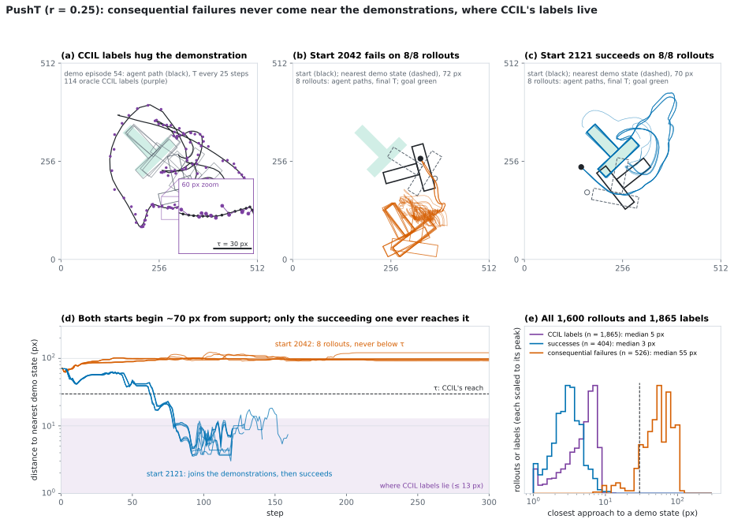

# PushT recovery at observed learner failures (protocol)

This is the protocol of [#66](https://github.com/personalrobotics/il-supervision-benchmarks/issues/66). Stage A was
frozen before any rollout from its starts was run; its machine-readable form is
[`tools/pusht_failure/stage-a.json`](../../tools/pusht_failure/stage-a.json).

**Question.** Where does a competent r = 0.25 Diffusion Policy actually fail on PushT, and can CCIL supply valid
recovery supervision there?

**Why.** Two indirect routes to the learner's failures stopped:
- Restored at demonstration prefixes, the base matched or beat the demonstration on 390/398 and 395/398 rollouts
  ([pusht-recovery.md](pusht-recovery.md#b2-result)).
- Disagreement between the two bases did not separate failed from successful episodes
  ([pusht-uncertainty.md](pusht-uncertainty.md#stage-a-result)).

This study replaces both with observed failure. The oracle CCIL label is the ceiling, so it is tested first, without
training.

## Stages

- **Stage A** (this protocol): discovery, reach and validity, with no training. **It stopped, and the study ended**
  ([result](#stage-a-result)).
- **Stage B**: only if Stage A passes on both bases, under its own protocol PR. It is
  [#52's matched comparison](pusht-recovery.md#b4-matched-comparison): the frozen base, self-distillation at the same
  states, and oracle recovery. It is evaluated on fresh starts 6000–6099.
- **Learned-dynamics CCIL:** only if oracle recovery helps.

A failed stage is terminal and published. No threshold, horizon, window or τ is searched after outcomes.

| Use | Starts |
|---|---|
| Discovery (Stage A) | 2000–2199 |
| Stage B evaluation | 6000–6099 (a development result) |
| Smoke | 3411–3420 |
| Final test | 5000–5099, not read |

No study has used starts 2000–2199 or 6000–6099; 6000–6099 is not read until Stage B's arms are frozen. Starts
1000–1099 are not used to evaluate this study: their outcomes were inspected repeatedly and motivated it.

## Stage A

**Status of the evidence.** Stage A is exploratory. Its failure definition was chosen after seeing #62's saved
development rollouts. About 40% of their failures never covered the goal, and about half were near misses at
0.8–0.95 maximum coverage, where 20–30% of success labels flip between processes. No rollout from Stage A's starts had
been run when it was frozen.

### Members

B1's two bases, unchanged ([stage-b-base.json](evidence/pusht-recovery/stage-b-base.json)): base 1 (model
`b4e025aa…`) and base 2 (model `fdc8cf40…`). They run in LeRobot's numerical mode, TF32 cuDNN convolutions, as #62
amended ([pusht-uncertainty.md](pusht-uncertainty.md#precision)). Bitwise reproducibility is required within siddh's
pinned environment, not across hardware.

### A1: discovery

- **Rollouts:** each base runs R = 4 rollouts from each start, driven as lerobot-eval drives it, through B2's driver
  ([`stage_b2.py`](../../tools/pusht_recovery/stage_b2.py)). Each starts at `env.reset(seed = start)` and runs to
  success or 300 steps.
- **Seeding:** the 4 repeats of a start run in lockstep as one batch. Before each chunk, torch is seeded with
  `SeedSequence([66, base, start, chunk])`, and batch row r is repeat r.
  - Each row's episode is recorded up to its own end.
  - The batch keeps stepping until all four rows end, so any chunk can be regenerated from the saved observations of
    all four rows.
- **Saved:** every step's observation, full simulator state, action and coverage, and every chunk's seed.
- **Consequential failure:** a rollout whose maximum coverage stays below **0.504**. That is B1's frozen competence
  line, half the hold-still (0.062) to demonstration-replay (0.946) gap.
  - A **failure start**, for a base, is one where at least 3 of its 4 repeats fail this way.
  - The failing rollouts of failure starts are Stage A's units.
- **Near misses:** rollouts with no success and maximum coverage of at least 0.504. They are reported descriptively
  only.

### A2: reach

- **State and distance:** #52's frozen geometry ([B0](pusht-recovery.md#b0-the-deviation-geometry)): Diffusion Policy's
  two-step observation as 18 points, and the largest per-point distance in px.
- **Support:** the 5,040 states of the r = 0.25 subset's 41 demonstrations.
- **Support distance:** d_sup(x) is the distance from x to the nearest support state.
- **τ = 29.76 px:** B0's threshold, the 99th percentile of one demonstration step plus the largest replay error
  ([support.json](evidence/pusht-recovery/support.json)). A state is in support when d_sup(x) ≤ τ.
- **Departure:** t_e is the first step t ≥ 1 where x_{t−1} is in support and x_t is not.
- **Matched row:** j* is the support state nearest x_{t_e − 1}. Its row j* + 8 must lie in the same episode.
- **Why the nearest state is a valid reference here:** B0 rejected cross-episode proximity as a continuation reference
  because an arbitrary state's nearest neighbour lies a median 33 px away. Here x_{t_e − 1} is within τ of j*, as close
  as one demonstration step.

Each failing rollout falls into one class:
1. **never in support:** no state is within τ;
2. **no departure:** some state is within τ, but it never leaves support from one;
3. **departs, ineligible:** j* + 8 is past the episode's end;
4. **departs, eligible:** a recovery window is attempted at t_e.

A rollout in class 1 or 2 is outside what a CCIL label can reach: CCIL's labels lie near demonstration states and steer
back to them.

**Reported descriptively, not gated:** the same classes and d_sup quantiles for successful and near-miss rollouts,
which show whether departures are specific to failure.

### A3: validity

The oracle CCIL ceiling at the departure. #52's [B3 solve](pusht-recovery.md#b3-oracle-recovery-windows) is used,
with its indexing corrected in review.

- **Indexing:** in LeRobot 0.6.1's Diffusion Policy, slot k of a window holds the action at time t_e + k − 1, and slots
  1–8 are the chunk executed from the observation (`action_delta_indices`, and `generate_actions` starting at
  n_obs_steps − 1).
- **Observations:** [x_{t_e − 1}, x_{t_e}], the rollout's own states, so they are physically realized.
- **Slot 0:** the action that produced x_{t_e}. It is history: the denoiser reads it, but it is **masked from the
  loss**. The departing action is never a training target.
- **Slots 1–8:** the first 8 actions applied from x_{t_e}. They are solved from the saved full state at t_e onto row
  j* + 8, with Stage A's settings ([`stage_a.py`](../../tools/pusht_recovery/stage_a.py)):
  - Gauss–Newton over the 16 values, with minimum-norm steps;
  - finite-difference step 1e-3, up to 20 iterations and 8 halvings per step;
  - starting from the demonstrated actions of rows j* … j* + 7;
  - converged when the chain's agent position and T pose after slot 8 are within 0.05 px of row j* + 8.
- **Slots 9–15:** the demonstrated actions from row j* + 8 on. Each is supervised while every chain state from slot 9
  on is within 1.0 px of its row and the row exists; the supervised slots are a prefix.
- **Checks:** Stage A's, unchanged:
  - every supervised action within [0, 512]²;
  - every chain state finite;
  - the speed envelope, and the penetration and extent envelope;
  - provenance;
  - an independent rebuild audit;
  - a byte-identical rerun.
- **One window per failing rollout,** at its departure. A rejected window is never replaced.

### Decision

For each base separately:
- **Refuse** as uninformative if it has fewer than 20 failure starts.
- **Pass** if at least 100 valid windows come from at least 20 distinct failure starts. That is #52's frozen B3 yield,
  the amount its fine-tuning needs.
- **Otherwise stop.**

Stage A passes only if both bases pass. **If Stage A stops, it is published and the study ends.** The record gives the
breakdown by class and by rejection reason.

### Audit and smoke

- **Audit:** in a fresh process for each base:
  - every chunk is regenerated bit for bit from the saved observations and seeds;
  - coverage is recomputed from the saved states (within 1e-9);
  - the labels, failure starts, d_sup, departures, matched rows and classes must be identical;
  - every accepted window is rebuilt independently, and every rejection must reproduce with its reason;
  - an independent simulator replay of the saved actions is reported as a measurement, not an equality gate (#53).
- **Smoke:** on starts 3411–3420, which no study uses:
  - a rerun is byte-identical;
  - the fresh audit passes;
  - injected faults are refused for the right reason: a changed action, a flipped label, a moved departure step, and
    a forged recovery chunk.
- **Compute:** siddh's two GPUs, one base each, unpaid.
  - From #62's measurement (0.35 s per chunk at batch 1, 0.40 s at batch 16): about 200 starts × 30 chunks × 0.36 s
    per batch of 4, or about 0.6 GPU-hours per base for discovery, and as long again for its audit.
  - A2 and A3 run on the CPU.
  - **Ceiling: 6 GPU-hours.** The code PR's smoke measures the cost, and the run starts only if its projection is
    within the ceiling.

### Implementation

[`tools/pusht_failure/failures.py`](../../tools/pusht_failure/failures.py) runs one base's discovery, then its reach
and windows, and writes its trajectories, windows and per-rollout table. Its `audit` mode is the fresh-process audit,
and `report` combines the two bases into the decision.
- **Driver:** #62's TF32 driver on a batch of 4 environments.
- **Durable trajectories:** they are written before labelling, and the record is written last.
- **Checks:** #52's checks, as they apply to a window that starts at a realized rollout state rather than a solved
  predecessor:
  - the speed envelope is checked at every chain state the recovery and the supervised continuation produce;
  - the contact envelope is checked at x_{t_e} and at those states;
  - #52's preceding-action check has no counterpart, since slot 0 is the realized action and is not solved;
  - slots 1–8 are supervised by construction.

[`tools/pusht_failure/smoke.py`](../../tools/pusht_failure/smoke.py) ran on starts 3411–3420 from a clean clone of
`c3bdd87`, with base 1. Its record is [`evidence/pusht-failure/smoke.json`](evidence/pusht-failure/smoke.json).
- **Rerun:** two runs wrote byte-identical records, trajectories and windows.
- **Audit:** every chunk regenerated bit for bit; the recomputed coverage agreed within 5e-10; the simulator replay
  matched exactly.
- **Faults:** each was refused for the right reason: a changed action, a flipped label, a moved departure and a forged
  window.
- **Construction:** on the smoke starts, windows are attempted at every eligible departure. Of the 40 rollouts, 12
  departed eligibly, and none of their windows was accepted: 10 solves failed and 2 had an action outside [0, 512].
  - Where the solve fails, the T must move 24–30 px while the agent is not in contact with it. The T's residual then
    has no gradient with respect to the actions, so the local solve cannot reduce it.
  - The 4 converging solves started with the agent already pushing the T.
  - This is a property of #52's frozen local solve and is not changed. If Stage A stops on it, the result will say so.

**Compute:** each smoke run took 173 s for 10 starts, and its audit as long. That projects to 1.9 GPU-hours per base,
3.9 for both, within the 6 GPU-hour ceiling. The projection counts the CPU labelling as GPU time.

### Stage A result

**Stop: almost no consequential failure comes within reach of demonstrated support, so almost no recovery window
exists.** Ran 2026-11-17 from a clean clone of `9666dba` on siddh. Record:
[`evidence/pusht-failure/stage-a.json`](evidence/pusht-failure/stage-a.json).

| Base | Rollouts | Successful | Near miss | Failure starts | Failing rollouts | Never in support | Eligible departures | Valid windows |
|---|---|---|---|---|---|---|---|---|
| 1 | 800 | 189 | 334 | 66 | 261 | 247 (95%) | 14 | 0 |
| 2 | 800 | 215 | 336 | 62 | 238 | 213 (89%) | 19 | 1 |

Both bases are informative: 66 and 62 failure starts, against the 20 required. The yield needs 100 valid windows from 20
failure starts per base; it got 0 and 1.

- **Consequential failures begin and stay outside demonstrated support.** The failing rollouts' closest approach to
  any demonstration state is a median of 58 px (base 1) and 55 px (base 2), against τ = 29.76 px.
  - Every successful rollout comes within τ, with a median closest approach of 3 px.
  - Only 4 and 6 of the 334 and 336 near misses never do.
  - The learner fails where the 41 demonstrations never went, not by drifting off a demonstrated path.
- **Where a failing rollout does depart, the frozen solve cannot recover it.**
  - Base 1: all 14 eligible departures failed to solve.
  - Base 2: 18 of 19 failed, and 1 window was accepted.
  - As in the smoke, these departures mostly need the T moved without the agent in contact, where the local solve has
    no gradient. This limits #52's local solve, not every possible oracle, but it touches at most 33 of the 499
    failing rollouts.
- **Departure is not specific to failure.** 61 and 86 successful rollouts depart eligibly too, and so do 129 and 154
  near misses.

**Audit:** in a fresh process for each base, every chunk regenerated bit for bit, and the labels, reach and windows
recomputed identically. Coverage recomputed from the saved states agreed within 5e-10, the accepted window landed
within 2.1e-5 px of its target, and the simulator replay matched exactly
([base 1](evidence/pusht-failure/stage-a-audit-b1.json), [base 2](evidence/pusht-failure/stage-a-audit-b2.json)).

**Compute:** 3.5 GPU-hours, within the 6 GPU-hour ceiling. Each base's discovery and labelling took 52 minutes, and its
audit 53.

**What this means for CCIL here.** CCIL's labels lie near demonstration states and steer back toward them. At
r = 0.25 the consequential failures of this learner happen at states the demonstrations never come near, so CCIL can
supply no valid recovery supervision there. This points to coverage of the start distribution rather than recovery
from drift, though Stage A does not test that. No τ, window, solve or threshold is changed, and Stage B does not run.

### Post hoc: initial support and failure geometry

Read-only and run after the decision, on the saved Stage A rollouts. It changes nothing above.

- **CCIL's labels sit close to the demonstrations** (a, e). #52 Stage A's 1,865 oracle labels lie a median of 5 px,
  and at most 13 px, from their demonstration states.
- **Failure is start-determined, but initial distance barely predicts it.**
  - 45 starts fail consequentially on all 8 rollouts (both bases, 4 repeats), and 112 on none.
  - At t = 0, 197 of 200 starts lie beyond τ from the 41-demonstration subset, successful ones included.
  - Initial distance separates mostly-failing starts with AUC 0.64 against the subset, and 0.58 against all 165
    training demonstrations.
- **It is the joint agent and T configuration that is far.**
  - The agent alone is within τ for 198 of 200 starts.
  - Every start begins at rest, so history adds 0.17 px.
  - The T alone is within τ for 60 starts against the subset, and 131 against all 165.
  - Scarcity explains little: 5 of 72 mostly-failing starts are far from the subset but near the full pool.
- **What separates outcomes is whether the rollout later reaches support** (b–d). Starts 2042 and 2121 both begin about
  70 px from support. 2121's rollouts fall below τ by about step 60, into the labels' band, and succeed. 2042's stay
  near 100 px for all 300 steps.

Record: [`evidence/pusht-failure/initial-support.json`](evidence/pusht-failure/initial-support.json), from
[`tools/pusht_failure/initial_support.py`](../../tools/pusht_failure/initial_support.py). The figure is drawn by
[`figure_data.py`](../../tools/pusht_failure/figure_data.py) and
[`figure.py`](../../tools/pusht_failure/figure.py), and it redraws byte-identically from the same data.
