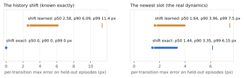
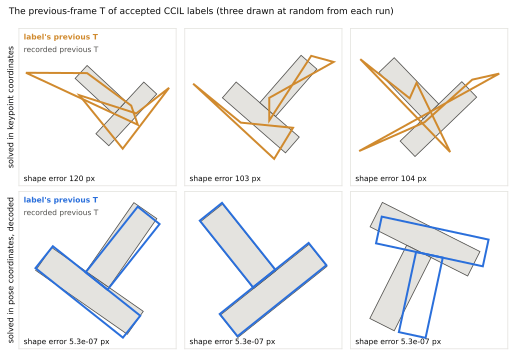
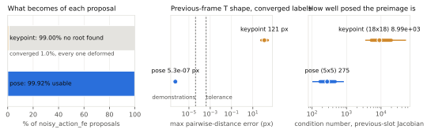

# PushT: generate labels where validity is defined

A cautionary record from PushT v2 (personalrobotics/CCIL#30). CCIL's one-step
preimage labels were generated directly in the coordinates the policy reads:
the T's eight keypoints, over a two-frame history. Two results:
- **Most labels didn't exist:** 99% of solves found no root.
- **The rest were impossible:** every label that did converge described a T
  that cannot exist.

Every check in the pipeline passed those labels except one: a rigidity check
derived from the demonstrations. Solving in the five physical coordinates
instead, and decoding back to keypoints, made 99.92% of the same proposals
usable.

## The setting

- **The policy's state:** the keypoint history x̄_t = [x_{t−1}, x_t]. That is
  the agent position (2 values) and the T's 8 keypoints (16), for the previous
  and the current frame. A single frame is not Markov: the agent is
  PD-controlled toward its action, so the next action depends on velocity.
- **The labels:** CCIL's `noisy_action_fe` solves, for each recorded transition
  (x̄_t, a_t, x̄_{t+1}) and a perturbed action ã, for a state h_G with
  h_G + f̂(h_G, ã) = x̄_{t+1}. Here f̂ is a spectrally constrained residual MLP
  fitted on the training episodes. The label is (h_G, ã).

## Lesson 1: encode the history shift, don't learn it

In a history state, the next state's older slot is this state's newer slot. A
generic residual MLP has to learn that identity, and it does so badly. It errs
more on the known shift than on the real dynamics. CCIL#196 adds
`transition_model.structure history_shift`: the shift is predicted exactly, and
the network learns only the newest slot. That also improves the part that is
actually learned.

*Held-out episodes, per-transition maximum error. Dot: median; bar: to the
90th percentile; tick: 99th percentile. Records:
[`history-fit.json`](evidence/pusht-v2/development/history-fit.json).*

## Lesson 2: in redundant coordinates, an exact residual is not a valid state

Even with the shift exact, the keypoint-space preimage asks Newton to find a
previous frame of 18 numbers from which ã reaches x_{t+1}. But the T's 16
keypoint coordinates carry only 3 rigid degrees of freedom. Of the previous
frame's coordinates, 13 move the next state hardly at all: the Jacobian's
median condition number is about 9,000.
- **Most solves diverge.** 99% of proposals found no root. Their final
  residuals sit 36–50 px from the target, and 1,000 iterations rescued 35 of
  2,000.
- **The solves that converge exploit the null directions.** They reach the
  target to 10⁻⁵ px by bending the previous frame's T out of shape. The median
  deformation was 121 px, against 4 × 10⁻⁵ px in the demonstrations.
- **A damped minimum-norm solve doesn't fix it.** It turns divergence into
  approximate answers whose residuals plateau near 0.02 px, two orders above
  the tolerance. Its few converged rows are deformed too.

*Three accepted labels drawn at random (seed 0) from each run. Grey: the
recorded previous-frame T at the label's source transition. Outline: the
label's. Top: CCIL solved in keypoint coordinates. Bottom: solved in pose
coordinates and decoded. Shape error: the largest deviation of the 28
keypoint-pair distances from the demonstrations'.*

These labels passed every other check:
- **Residual:** the residual was below 10⁻⁴.
- **History invariant:** it held exactly. The newest slot equals the source's
  x_t.
- **Yield gate:** CCIL's diagnosis gate admitted labels.
- **Curation and export:** both passed them.

Only a rigidity tolerance frozen from the demonstrations exposed them
([probe](evidence/pusht-v2/development/preimage-probe/probe.json)).

## The fix: solve in physical coordinates and decode

The T's pose (x, y, θ) is recovered from its keypoints by a closed-form rigid
fit, with θ unwrapped along each episode. The fit round-trips the recorded
keypoints to 4.7 × 10⁻⁵ px ([`pose.py`](../../tools/pusht_v2/pose.py)).
- **The model:** CCIL fits the same structured model on the pose history
  [q_{t−1}, q_t], with q = (agent x, y, T x, y, θ).
- **The solve:** it runs in five previous-frame coordinates, a 5 × 5 problem of
  median condition 275.
- **The decode:** each label's T pose becomes rigid keypoints. Its current
  halves are the source frame's own, so the policy reads exactly the keypoint
  history it was trained and gated on.

*Left: proposals from the keypoint-space probe (10,000, 50 Newton iterations)
and from the full pose-space run (100,952). Middle: T-shape error of converged
labels, log scale; dashed lines mark the demonstrations' largest deviation and
the frozen tolerance. Right: condition number of the previous-slot Jacobian at
2,000 source states. Records:
[`probe.json`](evidence/pusht-v2/development/preimage-probe/probe.json),
[`pose-probe.json`](evidence/pusht-v2/development/pose-probe/pose-probe.json),
[`lesson.json`](evidence/pusht-v2/lesson.json).*

With pose coordinates, 100,871 of 100,952 proposals were usable; the other 81
fell outside the action bounds. No label broke the residual, the history
invariant or the rigidity. The labels move the previous frame by a median of
14.6 px. They are alternative arrival velocities at demonstrated states, not
broad positional coverage.

## The principle

A synthetic observation needs one of three things:
- **unconstrained coordinates;**
- **a validity-preserving parameterization,** such as solving in physical
  coordinates and decoding;
- **a consumer that operates directly in the generated representation.**

Vector data is not safe merely because it is a vector, and a model residual
alone never establishes physical validity. CCIL's legitimate regimes follow:

1. **Known state or decoder.** Solve in physical coordinates, then render or
   decode the observation. PushT's pose-to-keypoints decode is this case.
2. **A trusted latent representation.** Generate (z_G, ã) and train a policy
   that consumes the same frozen latent. The artifact binds the encoder; it is
   not a raw-observation dataset any trainer can use.
3. **Neither.** CCIL cannot safely return synthetic observations. It should
   refuse, or only score and curate real ones.

Images sit at the far end of this scale. A preimage solved over pixels would
satisfy a learned dynamics model while depicting no possible scene. So raw
synthetic images need a simulator, a renderer or a trusted generative world
model. Otherwise the honest output is latent supervision with a consumer that
agrees to it.

## Reproduce

- **Records:** `uv run python tools/pusht_v2/lesson_records.py <keypoint-run labels>
  <pose-run directory> docs/studies/evidence/pusht-v2/lesson.json`, with the runs
  named in its docstring.
- **Figures:** `uv run --with matplotlib==3.10.9 python
  tools/pusht_v2/lesson_figures.py draw [--check]`, from the committed records
  alone.
- **Probes:** [`preimage_probe.py`](../../tools/pusht_v2/preimage_probe.py) and
  [`pose_probe.py`](../../tools/pusht_v2/pose_probe.py), each with its spec
  frozen before it ran.
