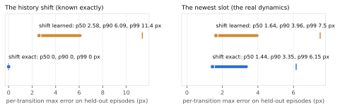
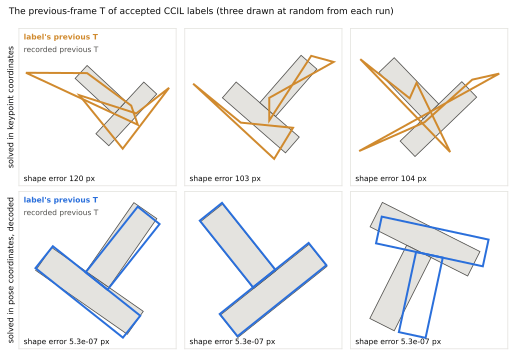
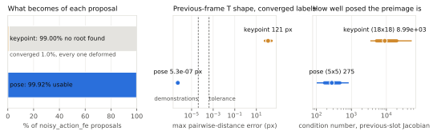

# PushT: what the one-step CCIL study established

This is the canonical account of the PushT keypoints study (personalrobotics/CCIL#30). The broader study of real-data
fraction and synthetic exposure continues in [#5](https://github.com/personalrobotics/il-supervision-benchmarks/issues/5),
which treats this result as one measured operating point.

## Conclusion

With a competent single-step IBC learner on a two-frame history state and structurally valid one-step CCIL labels,
an 80% CCIL training mixture **lowered** closed-loop coverage. It fell relative to both source-matched duplication
(−0.092, interval [−0.179, −0.004]) and BC (−0.117). That conclusion is scoped to this learner, this held-out InfoNCE
checkpoint selection, this label recipe and this synthetic dose. It is not a claim that corrective labels are harmful
in general. Selection kept CCIL's first checkpoint (5k) on every seed, against 10k for the other arms
([below](#result)).

Three findings made the comparison meaningful:
1. **The policy must see a history.** A single PushT frame is not Markov. Single-frame learners stayed near the
   hold-still floor.
2. **A multimodal single-step learner is competent.** IBC on the two-frame history recovers 0.85 of the
   hold-to-demonstrator gap.
3. **Labels must be generated where validity is defined.** Preimages solved in keypoint coordinates are not
   physically possible Ts. Solving in the T's pose and decoding gives rigid labels.

## Setting

- **Data:** `lerobot/pusht_keypoints` at revision `ace8c161`: 206 episodes, the agent position (2) and the T's 8
  keypoints (16) per frame.
- **Split:** CCIL's split. 41 episodes are held out for checkpoint selection only, and 165 train every arm and the
  dynamics model.
- **Evaluation:** unchanged `lerobot-eval` on 100 fixed starts (seeds 1000–1099).
- **Metric:** average maximum coverage of the target. Success is coverage ≥ 0.95.
  - Holding the agent still scores 0.0620.
  - Replaying the demonstrations scores 0.9464.
- **Stack:** LeRobot 0.6.1, `lerobot-train` and `lerobot-eval` unchanged. The policy and the history state are LeRobot
  plugins.

## 1. The policy must see a history

The first protocol trained single-frame ACT (chunk 1) on BC, duplication and CCIL. Every arm stayed near the floor:
mean coverage 0.124, 0.110 and 0.132, with 0–1% success. The CCIL contrast is therefore not evidence about CCIL.
Reference behaviours on the same starts locate the cause:

| policy | coverage | success |
|---|---|---|
| hold still | 0.062 | 0% |
| single-frame ACT (the arms) | 0.110–0.132 | 0–1% |
| single-frame ACT, keypoints normalized | 0.161 | 0% |
| ACT, LeRobot defaults (chunk 100) | 0.392 | 0% |
| diffusion, 2 observation steps | 0.948 | 71% |
| demonstrations replayed | 0.946 | 3% |

The agent is PD-controlled toward its action, so the next action depends on its velocity, which one frame does not
contain. On held-out frames, extrapolating the agent's last displacement twice predicts the action to 9.0 px; its
current position alone, to 24.2 px. Chunking and observation history recover what one frame cannot see.

## 2. A competent single-step learner

CCIL's labels are one (state, action) pair each, so the learner must predict one action.

- **Point regression fails closed loop.** Single-action regression on the two-frame history state cut held-out action
  error to about 10 px. On 50 starts, though, no checkpoint through 80k scored above 0.084, against 0.049 for holding
  still. A regressor averages PushT's several valid pushes, and the averaged action drifts.
- **IBC succeeds.** The learner is an energy MLP over [o_{t−1}, o_t, a] (4 × 1024), trained by InfoNCE against 1024
  uniform negatives, with sampling-and-refinement inference. It ports the published PushT low-dimensional IBC and
  runs as a LeRobot plugin. Checkpoints are selected by held-out InfoNCE and never by simulator returns.

| gate | seed 1 | seed 2 | seed 3 | mean | fraction of the gap | selected |
|---|---|---|---|---|---|---|
| 200k steps | 0.7988 | 0.8348 | 0.8304 | 0.8213 | 0.859 | 20k, every seed |
| 50k steps, compiled, bf16 | 0.8672 | 0.8494 | 0.7149 | 0.8105 | 0.846 | 10k, every seed |

Both pass the predeclared bar of 0.5 of the hold-to-demonstrator gap. The 50k settings are the study's: compiled
bf16 training runs 2.21× faster per step. bf16 changes the arithmetic, which is why the gate was rerun under exactly
these settings.

**Held-out InfoNCE is not closed-loop quality.** After its minimum, held-out InfoNCE rises while closed-loop coverage
keeps improving. In the 200k gate, seed 1 went from InfoNCE 1.254 and 0.756 coverage on 50 monitoring starts at 20k to
2.775 and 0.943 at 200k. The monitoring decided nothing. It shows that the selection rule favours early checkpoints.

## 3. Generate labels where validity is defined

CCIL's one-step label for a recorded transition (x̄_t, a_t, x̄_{t+1}) and a perturbed action ã is a state h_G with
h_G + f̂(h_G, ã) = x̄_{t+1}, where f̂ is a spectrally constrained residual MLP fitted on the training episodes.

**Encode the history shift; don't learn it.** In a history state, the next state's older slot is this state's newer
slot. A generic MLP learns that identity worse than the real dynamics: median held-out error 2.58 px on the shift
against 1.64 px on the newest slot. CCIL's `transition_model.structure history_shift` predicts the shift exactly, and
the newest slot improves to 1.44 px.

**In redundant coordinates, an exact residual is not a valid state.** The T's 16 keypoint coordinates carry 3 rigid
degrees of freedom. The previous-slot Jacobian's median condition number is about 9,000.
- **Few roots:** Newton found a root for 1.0% of proposals.
- **Deformed Ts:** those roots reach the target to 10⁻⁵ px by deforming the previous frame's T, by a median of 121 px
  against at most 4.1 × 10⁻⁵ px in the demonstrations.
- **Damping doesn't help:** a damped minimum-norm solve plateaus at residuals near 0.02 px, far above the tolerance.

These labels pass the residual, the history invariant, the yield gate, curation and export. Only a rigidity check
frozen from the demonstrations rejects them.

**Solve in the pose and decode.** The T's pose (x, y, θ) comes from its keypoints by a closed-form rigid fit, with θ
unwrapped per episode; the fit round-trips the recorded keypoints to 4.7 × 10⁻⁵ px. CCIL fits the same structured
model on the pose history [q_{t−1}, q_t], q = (agent x, y, T x, y, θ), and solves a 5 × 5 problem of median condition
275. Each label's T pose decodes to rigid keypoints. Its current halves are the source frame's own, so the policy
reads exactly the state it was gated on. 99.92% of proposals become usable labels; the rest fall outside the action
bounds.

The principle carries beyond PushT. A synthetic observation needs one of three things:
- unconstrained coordinates;
- a validity-preserving parameterization, such as solving in physical coordinates and decoding;
- a consumer that operates in the generated representation itself.

A model residual alone never establishes physical validity. That is why raw synthetic images need a simulator, a
renderer or a trusted world model.

## 4. The study

**Question.** Does one-step CCIL supervision help IBC beyond the same amount of duplicated demonstration supervision?
The primary contrast is CCIL − duplication on coverage; CCIL − BC is secondary.

**Protocol.** It was frozen at `1ddeb11` before any of its policies trained. Its machine-readable files are
[`protocol.json`](../../tools/pusht_v2/protocol.json) and [`pusht.yaml`](../../tools/pusht_v2/pusht.yaml). Paths inside
the frozen files refer to the archive tag below.

- **Labels:** CCIL `a995ff9`, generated in the pose history as above.
  - The dynamics model is fitted on the training episodes only.
  - Generation uses `noisy_action_fe`: 4 proposals per training transition, noise 0.1 training-action standard
    deviations, M = 1.
  - Every accepted label is kept with weight 1.
- **Correctness:** each label must have a residual ≤ 10⁻⁴, an exact history invariant and a rigid T in both slots. One
  violation stops the run.
- **Containment:** labels enter an arm only when sourced in a training episode. The check runs by source and by
  content, on the written datasets, and again in the audit.
- **Arms:** each is a LeRobot dataset of the 165 training episodes (20,335 frames), plus:
  - **bc:** nothing;
  - **ccil:** one one-frame episode per decoded label;
  - **duplication:** for each label, in order, a one-frame copy of its source frame. These are the same source rows
    as ccil's, checked by hash.
- **Training:** IBC as in the 50k gate, batch 256, a checkpoint every 5k, seeds 1–5. Every unit saw 12.8 M samples.
- **Selection:** each unit's checkpoint with the lowest held-out InfoNCE, with negatives fixed from seed 0. Ties go to
  the earlier checkpoint.
- **Signal rule:** a mean primary contrast above 0 and a positive contrast on at least 4 of 5 seeds.

**Labels.**
- **Yield:** 80,604 of the 80,680 training proposals were selected (99.91%), with no residual, invariant, rigidity or
  containment violation.
- **Mixture:** the labels make up 80% of the ccil arm's rows.
- **What a label is:** an alternative arrival velocity at a demonstrated state. Its previous frame moves a median
  14.5 px from the source's, and it adds no broad positional coverage.

### Result

**No signal; CCIL lowered coverage.**

| seed | bc | duplication | ccil | ccil − duplication | ccil − bc |
|---|---|---|---|---|---|
| 1 | 0.8672 | 0.8789 | 0.7062 | −0.1727 | −0.1609 |
| 2 | 0.8494 | 0.7692 | 0.7708 | +0.0016 | −0.0786 |
| 3 | 0.7149 | 0.7722 | 0.7215 | −0.0507 | +0.0066 |
| 4 | 0.8792 | 0.7372 | 0.6457 | −0.0915 | −0.2335 |
| 5 | 0.7966 | 0.8262 | 0.6802 | −0.1460 | −0.1164 |
| **mean** | **0.8215** | **0.7967** | **0.7049** | **−0.0919** | **−0.1166** |

Coverage over 100 starts at each unit's selected checkpoint. Intervals are 0.95, the union of a BCa bootstrap and a
paired t interval.

- **Primary, CCIL − duplication:** −0.092 [−0.179, −0.004], positive on 1 of 5 seeds. The signal rule is not met.
- **CCIL − BC:** −0.117 [−0.228, −0.005].
- **Success rate:** bc 24.0%, duplication 20.0%, ccil 11.4%. CCIL − duplication −8.6 points [−15.5, −1.7]; CCIL − BC
  −12.6 points [−17.8, −7.4].
- **Selection:** bc and duplication selected 10k on every seed except duplication-s1 (15k). ccil selected 5k on every
  seed. Its held-out InfoNCE was 2.27–2.35 there, against 1.14–1.22 for the other arms, and rose to 3.52–3.60 by
  50k. Whether a later CCIL checkpoint would control better was not measured; the frozen rule never
  consults simulator returns.
- **Audit:** passed. A repeat evaluation reproduced every episode, with rewards within 4.4 × 10⁻¹⁶.

## Records and reproduction

Compact records, each naming the sha256 of the original files it was extracted from:
- [`results.json`](evidence/pusht/results.json): the study's per-seed values, contrasts and selection histories, and
  the first protocol's results and references.
- [`gate.json`](evidence/pusht/gate.json): both IBC gates, the point-regression gate's monitoring, and the
  precision and compilation benchmark.
- [`labels.json`](evidence/pusht/labels.json): the study's label set, containment and arm reconciliation.
- [`audit.json`](evidence/pusht/audit.json): the study's audit, exposure and adapter check.
- [`lesson/`](evidence/pusht/lesson): the figure inputs.

The complete records, including every run's logs and per-unit files and the development history, are at tag
[`pusht-evidence-archive-v1`](https://github.com/personalrobotics/il-supervision-benchmarks/tree/pusht-evidence-archive-v1).

The study's runners, gates and probes are at that tag too. To reproduce the study exactly, check it out and follow
its `docs/studies/pusht-v2.md`. This tree keeps the reusable pieces:

- [`env_plugin`](../../tools/pusht_v2/env_plugin) and [`ibc_plugin`](../../tools/pusht_v2/ibc_plugin): the LeRobot
  history-state environment and the IBC policy (`uv pip install` both into a LeRobot 0.6.1 environment);
- [`derive.py`](../../tools/pusht_v2/derive.py): the two-frame history dataset from `lerobot/pusht_keypoints`;
- [`pose.py`](../../tools/pusht_v2/pose.py): conversion between the T's keypoints and its rigid pose;
- [`check.py`](../../tools/pusht_v2/check.py): the check that simulator evaluation computes the derived features;
- [`lesson_figures.py`](../../tools/pusht_v2/lesson_figures.py): the figures, regenerated from `lesson/` with
  `uv run --with matplotlib==3.10.9 python tools/pusht_v2/lesson_figures.py draw --check`.
